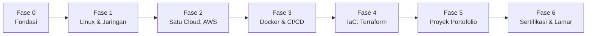

# Roadmap Belajar Cloud Engineering

> [!abstract] Tujuan
> Menyiapkan diri untuk **magang Cloud Engineer / DevOps** dengan bukti nyata: skill dasar, badge/sertifikat, dan minimal satu proyek deploy di AWS yang tampil di GitHub dan LinkedIn.

> [!tip] Cara memakai catatan ini
> Kerjakan fase berurutan. Centang `- [ ]` jika sudah selesai. Setiap fase punya **kenapa** (alasan), **apa yang dipelajari**, **tempat belajar**, dan **output** yang bisa dipamerkan.

---

## Peta Besar



| Fase | Fokus                                 | Perkiraan waktu | Output                     |
| ---- | ------------------------------------- | --------------- | -------------------------- |
| 0    | Fondasi (Git, Python, jaringan dasar) | 1-2 minggu      | Repo GitHub rapi           |
| 1    | Linux dan jaringan                    | 3-4 minggu      | Catatan + latihan terminal |
| 2    | AWS inti                              | 4-6 minggu      | Badge AWS/GCP              |
| 3    | Docker dan CI/CD                      | 3-4 minggu      | Pipeline GitHub Actions    |
| 4    | Terraform                             | 3-4 minggu      | Infrastruktur sebagai kode |
| 5    | Proyek portofolio                     | 4+ minggu       | Proyek live + README       |
| 6    | Sertifikasi dan melamar               | berjalan        | LinkedIn dan CV siap       |

> [!note] Waktu itu perkiraan
> Sesuaikan dengan jadwal kuliah. Lebih baik konsisten sedikit setiap hari daripada maraton sekali-sekali.

---

## Fase 0: Fondasi

**Kenapa:** semua pekerjaan cloud berbasis kode, versioning, dan jaringan. Fondasi yang rapi membuat fase berikutnya jauh lebih cepat.

- [ ] Git dan GitHub: branch, merge, pull request
- [ ] Python dasar untuk scripting (file, API, automasi sederhana)
- [ ] Rapikan profil GitHub (foto, bio, pin repo terbaik)

**Tempat belajar**

- [Git & GitHub Docs](https://docs.github.com/en/get-started)
- [freeCodeCamp](https://www.freecodecamp.org/) (kursus Git dan Python gratis)
- [Dicoding](https://www.dicoding.com/) (materi berbahasa Indonesia, sebagian gratis)

**Output:** repo GitHub dengan README yang jelas.

---

## Fase 1: Linux dan Jaringan

**Kenapa:** hampir semua server cloud berjalan di Linux, dan banyak masalah cloud sebenarnya masalah koneksi (DNS, port, firewall, subnet).

### Linux

- [ ] Navigasi file, permission (`chmod`, `chown`), user dan group
- [ ] Proses dan service (`ps`, `top`, `systemctl`)
- [ ] Membaca log (`journalctl`, `tail -f`, `grep`)
- [ ] SSH dan key-based authentication
- [ ] Bash scripting dasar (variabel, loop, kondisi)

### Jaringan

- [ ] IP address, subnetting (CIDR), gateway
- [ ] DNS, HTTP/HTTPS, TCP vs UDP, port
- [ ] Firewall dan NAT
- [ ] Lanjutkan Cisco Networking Academy setelah _Introduction to Networks_

**Tempat belajar**

- [Linux Journey](https://linuxjourney.com/) (gratis, bertahap)
- [OverTheWire: Bandit](https://overthewire.org/wargames/bandit/) (latihan terminal berbentuk game)
- [Cisco Networking Academy](https://www.netacad.com/) (lanjutan CCNA)
- [roadmap.sh/linux](https://roadmap.sh/linux)

> [!tip] Latihan praktis
> Pakai WSL2 + Ubuntu yang sudah ada di laptop. Coba setup SSH, buat user baru, pasang Nginx, lalu akses dari browser.

**Output:** catatan Obsidian per topik + satu script Bash yang berguna.

---

## Fase 2: Satu Platform Cloud (AWS)

**Kenapa:** konsep cloud mirip antar penyedia (compute, storage, jaringan, identitas). Dalam di satu platform lebih berharga daripada dangkal di tiga. AWS dipilih karena paling banyak dipakai di Indonesia.

### Layanan inti yang wajib paham

| Layanan    | Fungsi                 | Kenapa penting                              |
| ---------- | ---------------------- | ------------------------------------------- |
| IAM        | Pengguna, role, policy | Sumber salah konfigurasi keamanan terbanyak |
| EC2        | Server virtual         | Dasar compute                               |
| S3         | Penyimpanan objek      | Dipakai di hampir semua arsitektur          |
| VPC        | Jaringan privat        | Menghubungkan semua pengetahuan jaringan    |
| RDS        | Database terkelola     | Aplikasi nyata butuh database               |
| CloudWatch | Monitoring dan log     | Dasar observability                         |
| Route 53   | DNS                    | Menghubungkan domain ke aplikasi            |

- [ ] Buat akun AWS, **pasang budget alert** sebelum apa pun
- [ ] Aktifkan MFA, jangan pakai root account untuk pekerjaan harian
- [ ] Luncurkan EC2, SSH ke dalamnya, pasang web server
- [ ] Buat bucket S3 dan atur policy akses
- [ ] Buat VPC sederhana (public + private subnet)

> [!warning] Waspada biaya
> Selalu pasang **AWS Budgets** dan matikan atau hapus resource setelah latihan. Perhatikan batas Free Tier di halaman resmi AWS karena aturannya bisa berubah.

**Tempat belajar**

- [AWS Skill Builder](https://skillbuilder.aws/) (banyak kursus digital gratis, termasuk persiapan Cloud Practitioner)
- [AWS Educate](https://aws.amazon.com/education/awseducate/) (program untuk pelajar; cek persyaratan terbaru)
- [AWS Documentation](https://docs.aws.amazon.com/)
- [Google Cloud Skills Boost](https://www.cloudskillsboost.google/) (opsional, untuk perbandingan dan badge tambahan)

**Output:** satu web server di EC2 yang bisa diakses publik, dengan catatan arsitektur.

---

## Fase 3: Docker dan CI/CD

**Kenapa:** perusahaan men-deploy lewat container dan pipeline otomatis, bukan manual. Kamu sudah memakai Docker untuk menjalankan proyek tim, sekarang saatnya membuatnya sendiri.

### Docker

- [ ] Menulis `Dockerfile` untuk aplikasi sendiri
- [ ] Image vs container, layer, ukuran image
- [ ] `docker compose` untuk aplikasi multi-service (app + database)
- [ ] Volume dan network

### CI/CD

- [ ] Konsep: build, test, deploy
- [ ] GitHub Actions: jalankan test otomatis saat push
- [ ] Deploy otomatis ke server/AWS setelah test lulus

**Tempat belajar**

- [Docker Get Started](https://docs.docker.com/get-started/)
- [GitHub Actions Docs](https://docs.github.com/en/actions)
- [roadmap.sh/devops](https://roadmap.sh/devops)
- YouTube: TechWorld with Nana, KodeKloud (cari kata kunci "Docker tutorial for beginners")

**Output:** aplikasi dengan `Dockerfile` + workflow GitHub Actions yang berjalan hijau.

---

## Fase 4: Infrastructure as Code (Terraform)

**Kenapa:** membuat infrastruktur lewat klik di console tidak bisa diulang dan sulit dilacak. IaC membuat infrastruktur tertulis, bisa di-review, dan bisa dibuat ulang dalam menit. Ini yang membedakan pelamar biasa dengan yang siap kerja.

- [ ] Instal Terraform, pahami `init`, `plan`, `apply`, `destroy`
- [ ] Buat EC2 + security group lewat Terraform
- [ ] Pakai variable, output, dan state
- [ ] Simpan kode di GitHub (jangan commit secret atau file state)

**Tempat belajar**

- [HashiCorp Developer: Terraform tutorials](https://developer.hashicorp.com/terraform/tutorials)
- [Terraform AWS Provider docs](https://registry.terraform.io/providers/hashicorp/aws/latest/docs)

> [!warning] Keamanan
> Jangan pernah commit access key AWS ke GitHub. Pakai `.gitignore` dan variabel environment.

**Output:** repo Terraform yang membuat infrastruktur proyekmu dari nol.

---

## Fase 5: Proyek Portofolio

**Kenapa:** untuk mahasiswa tanpa pengalaman kerja, proyek adalah bukti kemampuan terkuat. Recruiter menilai praktik lebih tinggi dari teori.

### Ide proyek bertahap

1. **Deploy web statis ke S3 + CloudFront.** Termudah, cocok sebagai langkah pertama.
2. **Deploy aplikasi web (Laravel/Python) ke EC2 dengan Docker.** Menggabungkan Fase 2 dan 3.
3. **Tambahkan CI/CD:** push ke GitHub otomatis ter-deploy.
4. **Buat infrastrukturnya dengan Terraform.**
5. **Tambahkan monitoring dasar:** CloudWatch alarm saat server bermasalah.

### Format README yang disarankan

```
# Nama Proyek
Deskripsi satu kalimat: masalah yang diselesaikan.
## Arsitektur   (diagram)
## Teknologi    (AWS, Docker, Terraform, GitHub Actions)
## Cara menjalankan
## Yang dipelajari / tantangan
```

- [ ] Gambar diagram arsitektur (draw.io atau Excalidraw)
- [ ] Tulis README
- [ ] Masukkan ke bagian **Projects** di LinkedIn dan CV

---

## Fase 6: Sertifikasi dan Melamar

### Gratis vs berbayar

| Jenis                             | Contoh                                                     | Biaya                      |
| --------------------------------- | ---------------------------------------------------------- | -------------------------- |
| Badge/sertifikat penyelesaian     | Google Skill Badge, AWS Skill Builder badge, Cisco NetAcad | Gratis atau murah          |
| Sertifikasi resmi (ujian proktor) | AWS Cloud Practitioner, Google Cloud Associate             | Berbayar (cek harga resmi) |

> [!info] Catatan
> Badge adalah bukti belajar, bukan "certified". Tulis dengan jujur di profil. Untuk ujian resmi, cari voucher dari kampus, event, atau program mahasiswa sebelum membayar sendiri.

### Jalur sertifikasi yang disarankan

1. **AWS Certified Cloud Practitioner:** tahap pertama, konsep dasar cloud.
2. **AWS Certified Solutions Architect - Associate:** lebih teknis, sangat dihargai.
3. Opsional: **Google Cloud Associate Cloud Engineer** atau **HashiCorp Terraform Associate**.

### Sumber badge dan sertifikat gratis

- **Google Cloud Skills Boost:** [cloudskillsboost.google](https://www.cloudskillsboost.google/)
  - Gabung **Google Cloud Innovators** (gratis) untuk kredit belajar bulanan.
  - _Completion badge_ diberi setelah menyelesaikan materi, _skill badge_ setelah lulus challenge lab (lebih dihargai).
  - Pantau promo lab gratis saat event seperti Google Cloud Next dan I/O.
- **AWS Skill Builder dan AWS Educate:** lihat Fase 2.
- **Microsoft Learn:** [learn.microsoft.com](https://learn.microsoft.com/) (Azure, badge gratis)
- **Linux Foundation:** [training.linuxfoundation.org](https://training.linuxfoundation.org/) (kursus pengantar gratis, sertifikat berbayar)
- **Cisco Networking Academy:** [netacad.com](https://www.netacad.com/)
- **Coursera:** mode audit atau _financial aid_
- **Kampus Merdeka (MSIB):** program magang dan studi independen

### Checklist melamar magang

- [ ] LinkedIn: headline, About, Experience, Education, Skills, Projects terisi
- [ ] Open to Work diganti ke peran: Cloud Engineer Intern, DevOps Intern, IT Infrastructure Intern
- [ ] CV ramah ATS (satu halaman, keyword sesuai lowongan)
- [ ] GitHub rapi dengan proyek unggulan di-pin
- [ ] Job alert aktif di LinkedIn, Glints, Kalibrr, JobStreet
- [ ] Pantau situs karier langsung: bank, BUMN, telco, e-commerce
- [ ] Bergabung komunitas: AWS User Group Indonesia, GDG, grup devops Indonesia

**Kata kunci pencarian:** `cloud engineer intern`, `devops intern`, `magang cloud`, `junior cloud engineer`, `cloud support engineer`, `site reliability engineer`, `platform engineer`, `infrastructure engineer`

---

## Kebiasaan yang Mempercepat Belajar

1. **Catat dengan kata sendiri di Obsidian.** _Kenapa:_ menjelaskan ulang memaksa kamu benar-benar paham.
2. **Praktik lebih banyak dari menonton.** _Kenapa:_ skill cloud terbentuk dari mengerjakan lab dan membetulkan error.
3. **Dokumentasikan error dan solusinya.** _Kenapa:_ itu jadi bahan wawancara dan konten LinkedIn.
4. **Selalu matikan resource setelah latihan.** _Kenapa:_ mencegah tagihan tak terduga.
5. **Posting progres sesekali di LinkedIn.** _Kenapa:_ menambah visibilitas dan membuka peluang referral.

---

## Pelacak Progres

- [ ] Fase 0: Fondasi
- [ ] Fase 1: Linux dan Jaringan
- [ ] Fase 2: AWS inti
- [ ] Fase 3: Docker dan CI/CD
- [ ] Fase 4: Terraform
- [ ] Fase 5: Proyek portofolio
- [ ] Fase 6: Sertifikasi dan melamar

## Catatan Pribadi

- Tanggal mulai:
- Badge/sertifikat yang sudah didapat:
- Proyek yang sudah live:
- Kendala saat ini:

---

> [!warning] Cek ulang informasi
> Harga ujian, aturan Free Tier, kredit belajar, dan persyaratan program bisa berubah. Selalu verifikasi di situs resmi sebelum mendaftar.
